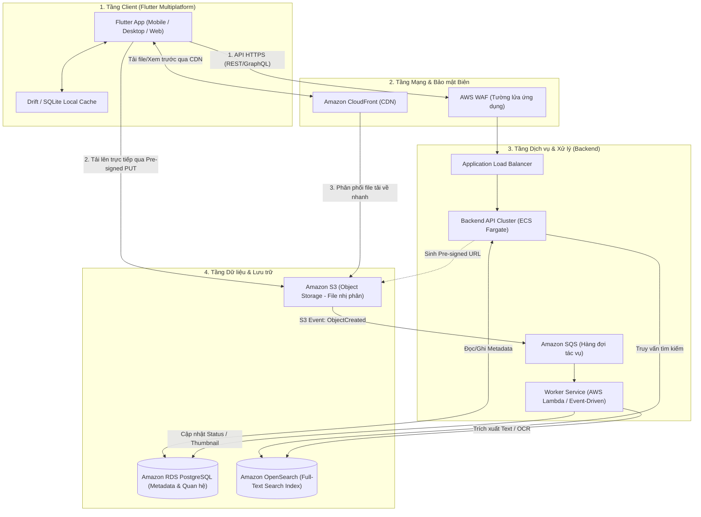
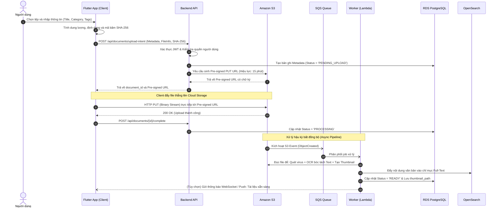
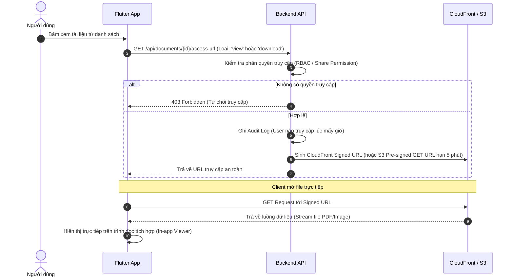

# Báo Cáo Phân Tích & Thiết Kế Kiến Trúc Cloud Hệ Thống Quản Lý Tài Liệu (DMS)

> **Dự án:** Quản lý tài liệu học tập (`learning_docs` / `qltlht`)  
> **Tài liệu:** Đánh giá hiện trạng, Phân tích điểm nghẽn hạ tầng truyền thống và Thiết kế kiến trúc tích hợp Cloud.

---

## MỤC LỤC
1. [Phần I: Phân Tích Các Thành Phần Cốt Lõi Của Ứng Dụng DMS](#phần-i-phân-tích-các-thành-phần-cốt-lõi-của-ứng-dụng-dms)
2. [Phần II: Điểm Nghẽn & Hạn Chế Khi Vận Hành Trên Hạ Tầng Truyền Thống](#phần-ii-điểm-nghẽn--hạn-chế-khi-vận-hành-trên-hạ-tầng-truyền-thống)
3. [Phần III: Lựa Chọn Mô Hình Triển Khai Cloud & Các Dịch Vụ Cụ Thể](#phần-iii-lựa-chọn-mô-hình-triển-khai-cloud--các-dịch-vụ-cụ-thể)
4. [Phần IV: Sơ Đồ Kiến Trúc Tích Hợp Cloud & Luồng Dữ Liệu](#phần-iv-sơ-đồ-kiến-trúc-tích-hợp-cloud--luồng-dữ-liệu)
5. [Phần V: Lộ Trình Tái Cấu Trúc & Tích Hợp Vào Mã Nguồn Hiện Tại](#phần-v-lộ-trình-tái-cấu-trúc--tích-hợp-vào-mã-nguồn-hiện-tại)

---

## PHẦN I: PHÂN TÍCH CÁC THÀNH PHẦN CỐT LÕI CỦA ỨNG DỤNG DMS

Nguyên tắc thiết kế tối quan trọng của hệ thống Quản lý tài liệu (Document Management System - DMS) hiện đại là: **Tách rời Metadata (dữ liệu mô tả) và File Content (dữ liệu nhị phân thô)**.

```
┌────────────────────────────────────────────────────────┐
│                   ỨNG DỤNG QUẢN LÝ TÀI LIỆU            │
└───────────────────────────┬────────────────────────────┘
                            │
        ┌───────────────────┴───────────────────┐
        ▼                                       ▼
┌──────────────────────────────┐ ┌──────────────────────────────┐
│       DATABASE (METADATA)    │ │   FILE STORAGE (BINARY BLOB) │
│ - Tiêu đề, Tác giả, Tag, Mô tả│ │ - Tệp PDF, DOCX, XLSX, Ảnh   │
│ - Dung lượng, MIME, SHA-256  │ │ - Video bài giảng, Tệp nén   │
│ - Đường dẫn tệp / Storage Key│ │ - Lưu trữ phân tán, mã hóa   │
└──────────────────────────────┘ └──────────────────────────────┘
```

### 1. Frontend (Giao diện người dùng & Tương tác)
* **Vai trò:** Tiếp nhận thao tác người dùng, hiển thị cấu trúc tài liệu, quản lý trạng thái tải lên/tải xuống và hỗ trợ đọc/xem trước tài liệu.
* **Các module chức năng cốt lõi:**
  * **File Uploader:** Kéo-thả (Drag & Drop), chọn nhiều tệp (multi-file), hiển thị thanh tiến trình tải lên, hỗ trợ tải lên phân đoạn (chunked/resumable upload) cho tệp lớn.
  * **Document Viewer/Previewer:** Tích hợp bộ đọc trực tiếp các định dạng phổ biến (PDF, Office, Markdown, Image) ngay trên giao diện mà không bắt buộc tải về máy.
  * **Search & Filter UI:** Bộ lọc đa tiêu chí (danh mục, khoảng ngày tạo, loại tài liệu, tác giả, thẻ phân loại) kèm thanh tìm kiếm từ khóa hỗ trợ gợi ý (autocomplete).
  * **Folder/Tree Explorer & Tagging:** Cây thư mục phân cấp và quản lý nhãn dán.
  * **Version & Activity History:** Xem lại lịch sử các phiên bản sửa đổi và nhật ký xem/chỉnh sửa.

### 2. Backend (Tầng xử lý logic nghiệp vụ & Dịch vụ nền)
* **Vai trò:** Điều phối toàn bộ luồng nghiệp vụ, xác thực, bảo mật phân quyền và quản lý tiến trình xử lý tệp.
* **Các dịch vụ cốt lõi:**
  * **API Service:** Cung cấp chuẩn giao tiếp RESTful API hoặc GraphQL/gRPC.
  * **Authentication & Authorization (IAM/RBAC/ABAC):** Kiểm soát truy cập nghiêm ngặt theo vai trò (Owner, Editor, Viewer).
  * **Document Processing Service (Async Pipeline):**
    * *Text Extraction & OCR:* Trích xuất văn bản từ PDF/ảnh để phục vụ đánh chỉ mục tìm kiếm full-text.
    * *Thumbnail Generation:* Tự động tạo ảnh đại diện trang đầu của tài liệu.
    * *Antivirus Scanning:* Tự động quét mã độc tệp tải lên trước khi phê duyệt lưu trữ.
  * **Indexing Adapter:** Đồng bộ hóa dữ liệu đã bóc tách sang Search Engine.
  * **Audit Logging:** Ghi nhận mọi sự kiện phát sinh (ai tải, xem, sửa, xóa vào thời điểm nào).

### 3. Database (Cơ sở dữ liệu lưu trữ Metadata & Quan hệ)
* **Vai trò:** Lưu trữ toàn bộ dữ liệu có cấu trúc, quan hệ phân cấp, chỉ mục tìm kiếm nhanh. Tuyệt đối không lưu tệp nhị phân kích thước lớn trực tiếp trong bảng dữ liệu.
* **Cấu trúc thực thể cốt lõi:**
  * `documents`: `id`, `title`, `description`, `type`, `storage_key`, `file_size`, `mime_type`, `file_hash` (SHA-256), `current_version`, `status`, `created_at`, `updated_at`.
  * `document_versions`: `id`, `document_id`, `version_number`, `storage_key`, `file_size`, `change_log`, `created_by`, `created_at`.
  * `categories / folders`: `id`, `name`, `parent_id` (hỗ trợ phân cấp cây đệ quy).
  * `tags` & `document_tags`: Liên kết nhiều-nhiều phục vụ gắn nhãn tài liệu.
  * `permissions / shares`: `id`, `document_id`, `user_id`, `permission_level` (`read`, `write`, `admin`).
  * `audit_logs`: Ghi nhận nhật ký thao tác và IP truy cập.

### 4. File Storage (Lưu trữ tệp tin vật lý / Nhị phân)
* **Vai trò:** Cung cấp không gian lưu trữ an toàn, tin cậy cao (độ bền 99.999999999%) và khả năng mở rộng không giới hạn cho tệp nhị phân thực tế.
* **Các kỹ thuật bắt buộc:**
  * **Pre-signed URL (Direct Upload/Download):** Cấp phát URL có chữ ký và thời hạn ngắn để client thao tác trực tiếp với kho lưu trữ, tránh nghẽn băng thông backend.
  * **Data Deduplication (Khử trùng lặp):** So sánh mã băm SHA-256 để tránh lưu trữ nhiều bản sao vật lý của cùng một file.
  * **Mã hóa (Encryption):** Mã hóa ở trạng thái nghỉ (AES-256) và trạng thái truyền tải (TLS 1.3).
  * **Lifecycle Tiering:** Tự động chuyển tệp cũ sang kho lưu trữ giá rẻ (Cold/Archive).

---

## PHẦN II: ĐIỂM NGHẼN & HẠN CHẾ KHI VẬN HÀNH TRÊN HẠ TẦNG TRUYỀN THỐNG

Khảo sát trực tiếp mã nguồn hiện tại của dự án (`qltlht`) cho thấy các điểm nghẽn nghiêm trọng khi chạy trên hạ tầng vật lý/máy chủ truyền thống (On-Premise / Traditional VMs):

```
                                  [MÁY CHỦ TRUYỀN THỐNG]
                                             │
      ┌──────────────────────────────────────┼──────────────────────────────────────┐
      ▼                                      ▼                                      ▼
[TẦNG DATABASE]                        [TẦNG STORAGE]                        [TẦNG XỬ LÝ (COMPUTE)]
- SharedPreferences lưu 1 chuỗi JSON   - Lưu Absolute Path trên máy trạm     - Xử lý đồng bộ trên web thread
- OOM khi dữ liệu lớn                  - Gãy liên kết khi đổi máy/đổi tên    - Chiếm dụng tài nguyên
- Quét tìm kiếm tuyến tính O(N)       - Nghẽn I/O đĩa máy chủ               - Single Point of Failure (SPOF)
```

### 1. Điểm nghẽn ở Tầng Database & Quản lý dữ liệu
* **Mô hình SharedPreferences JSON Monolithic:**
  * Mã nguồn [`PreferencesDocumentLocalDataSource`](file:///c:/Dart/qltlht/lib/features/documents/data/datasources/document_local_datasource.dart) lưu toàn bộ tài liệu vào 1 key duy nhất `learning_docs.documents.v1`.
  * Mỗi thao tác Thêm/Sửa/Xóa đều phải đọc toàn bộ chuỗi JSON vào RAM, giải mã `jsonDecode`, cập nhật mảng và `jsonEncode` để ghi đè lại toàn bộ tệp xuống đĩa.
  * **Hậu quả:** Gây cạn kiệt bộ nhớ RAM (Out Of Memory - OOM), hao mòn I/O đĩa và crash ứng dụng khi số lượng tài liệu tăng lên hàng nghìn bản ghi.
* **Xung đột ghi đồng thời (Race Condition):**
  * Không có cơ chế Transaction và Row-level Lock. Khi nhiều người cùng cập nhật metadata, thao tác ghi sau sẽ ghi đè và làm mất dữ liệu của thao tác trước (Lost Updates).
* **Tìm kiếm tuyến tính O(N) trong bộ nhớ:**
  * Phương thức [`DocumentRepositoryImpl.search`](file:///c:/Dart/qltlht/lib/features/documents/data/repositories/document_repository_impl.dart) quét tuần tự toàn bộ danh sách bằng vòng lặp `where`, nối chuỗi và so sánh `contains()`.
  * **Hậu quả:** CPU tăng vọt 100%, không hỗ trợ Inverted Index hay Full-Text Search bên trong nội dung tài liệu.

### 2. Điểm nghẽn ở Tầng Lưu trữ Tệp (File Storage & I/O)
* **Gãy liên kết tệp cục bộ (Broken Links):**
  * [`DocumentFormPage._pickFile`](file:///c:/Dart/qltlht/lib/features/documents/presentation/pages/document_form_page.dart) chỉ lưu đường dẫn tuyệt đối (`file.path`, ví dụ: `C:\Users\...\tailieu.pdf`).
  * Nếu người dùng chuyển máy tính, đổi tên thư mục hoặc truy cập từ xa, tệp lập tức không thể mở được.
* **Nghẽn băng thông và I/O đĩa máy chủ:**
  * Trên hạ tầng truyền thống, mọi thao tác tải lên/tải xuống tệp lớn đều phải đi xuyên qua máy chủ backend, gây nghẽn cổ chai cổng mạng và kiệt quệ IOPS đĩa cứng.
* **Không có khử trùng lặp (No Deduplication):**
  * Cùng một tài liệu 500MB nếu được 10 người tải lên sẽ chiếm 5GB dung lượng đĩa do thiếu cơ chế kiểm tra mã băm SHA-256.
* **Giới hạn dung lượng vật lý:**
  * Dung lượng ổ cứng máy chủ/NAS là cố định. Khi đầy ổ đĩa, việc mở rộng đòi hỏi dừng dịch vụ (Downtime) để lắp đặt phần cứng.

### 3. Điểm nghẽn ở Tầng Backend & Năng lực tính toán
* **Xử lý đồng bộ gây tắc nghẽn (Server Starvation):**
  * Các tác vụ nặng như OCR, bóc tách văn bản, tạo thumbnail nếu chạy trực tiếp trên worker thread của máy chủ API sẽ chiếm dụng hết tài nguyên, dẫn đến lỗi timeout và từ chối dịch vụ (HTTP 504/503).
* **Điểm lỗi đơn lẻ (Single Point of Failure - SPOF):**
  * Toàn bộ hệ thống chạy trên một máy chủ duy nhất. Sự cố phần cứng, sập nguồn hoặc lỗi hệ điều hành sẽ làm tê liệt toàn bộ ứng dụng.

### 4. Bảng tổng hợp rủi ro & giải pháp cải tiến

| Thành phần | Điểm nghẽn hiện tại | Mức độ rủi ro | Giải pháp cải tiến trên Cloud |
| :--- | :--- | :---: | :--- |
| **Database** | SharedPreferences lưu JSON, quét tuyến tính $O(N)$ | **Rất cao (Critical)** | Managed PostgreSQL (Amazon RDS) kết hợp SQLite ([Drift](file:///c:/Dart/qltlht/lib/core/database/app_database.dart)) cho Offline Cache |
| **File Storage** | Lưu absolute path máy trạm, nghẽn I/O server | **Rất cao (Critical)** | Object Storage (Amazon S3 / MinIO) + Pre-signed URL |
| **Search** | Tìm kiếm chuỗi thô trong RAM | **Trung bình** | OpenSearch / Elasticsearch Full-Text Indexing |
| **Xử lý nền** | Không có hàng đợi xử lý | **Cao** | SQS + Serverless Lambda Workers xử lý OCR, Thumbnail |
| **File Viewer** | Phụ thuộc ứng dụng máy trạm ([`OpenFilex`](file:///c:/Dart/qltlht/lib/features/documents/presentation/pages/document_detail_page.dart)) | **Trung bình** | Tích hợp In-app PDF/Document Viewer trực tiếp |

---

## PHẦN III: LỰA CHỌN MÔ HÌNH TRIỂN KHAI CLOUD & CÁC DỊCH VỤ CỤ THỂ

### 1. Đánh giá các mô hình Cloud
1. **Public Cloud (Khuyến nghị số 1 cho hầu hết dự án):**
   * *Ưu điểm:* Khả năng mở rộng vô hạn, thanh toán theo mức sử dụng (Pay-as-you-go), độ bền bỉ dữ liệu đạt chuẩn 11 số 9 (99.999999999%), không tốn chi phí mua sắm và bảo trì phần cứng.
   * *Phù hợp:* Ứng dụng học tập, trường học, viện đào tạo, doanh nghiệp vừa và nhỏ (SME), hệ sinh thái EdTech.
2. **Hybrid Cloud (Lựa chọn thay thế cho đơn vị đặc thù):**
   * *Ưu điểm:* Lưu trữ tài liệu mật/nhạy cảm on-premise nhưng vẫn tận dụng được sức mạnh tính toán và CDN của Public Cloud.
   * *Phù hợp:* Ngân hàng, cơ quan nhà nước, bệnh viện có quy định bảo mật bắt buộc dữ liệu không được rời khỏi trung tâm dữ liệu nội bộ.

### 2. Ma trận dịch vụ tương đương giữa các nền tảng

| Thành phần kiến trúc | **AWS (Đề xuất tối ưu)** | **Google Cloud (GCP)** | **Microsoft Azure** | **On-premise / Hybrid** |
| :--- | :--- | :--- | :--- | :--- |
| **Object Storage (Tệp tin)** | **Amazon S3** | Cloud Storage (GCS) | Azure Blob Storage | **MinIO** (Chuẩn S3) |
| **Database (Metadata)** | **Amazon RDS PostgreSQL** | Cloud SQL PostgreSQL | Azure DB for PostgreSQL | PostgreSQL HA (Patroni) |
| **Compute / API Server** | **AWS ECS Fargate** | Google Cloud Run | Azure Container Apps | Kubernetes (K8s) |
| **Async Worker (OCR, Thumb)** | **AWS SQS + Lambda** | Cloud Tasks + Functions | Queue + Azure Functions | Celery + RabbitMQ |
| **Full-text Search** | **Amazon OpenSearch** | Cloud Search / GKE Elastic | Azure AI Search | MeiliSearch / Elastic |
| **CDN & Tăng tốc** | **Amazon CloudFront** | Cloud CDN | Azure CDN | Nginx + Cloudflare |

### 3. Chiến lược tối ưu chi phí lưu trữ tệp (Storage Tiering)
Cấu hình **S3 Lifecycle Rules** để tự động chuyển vùng lưu trữ theo tuổi thọ tệp:
* **0 - 90 ngày (Hot Tier - S3 Standard):** Dành cho tài liệu mới tải lên, tần suất truy cập cao.
* **91 - 365 ngày (Warm Tier - S3 Standard-IA):** Dành cho tài liệu ít truy cập hơn (tiết kiệm ~50% chi phí lưu trữ).
* **Sau 365 ngày (Cold/Archive - S3 Glacier Flexible Deep Archive):** Chuyển vào kho lưu trữ nén bảo lưu (tiết kiệm đến 85-95% chi phí).

---

## PHẦN IV: SƠ ĐỒ KIẾN TRÚC TÍCH HỢP CLOUD & LUỒNG DỮ LIỆU

### 1. Sơ đồ kiến trúc tổng thể



---

### 2. Luồng dữ liệu 1: Tải lên tài liệu mới (Direct Upload qua Pre-signed URL)



---

### 3. Luồng dữ liệu 2: Xem trước và Tải về an toàn (Secure Preview & Download)



---

### 4. Luồng dữ liệu 3: Tìm kiếm toàn văn (Full-Text Search)
1. Người dùng nhập từ khóa trên [`SearchPage`](file:///c:/Dart/qltlht/lib/features/search/presentation/pages/search_page.dart).
2. App gửi truy vấn tìm kiếm đến API Backend.
3. Backend truy vấn song song trên **Amazon OpenSearch**:
   * Khớp từ khóa trên các trường Metadata (Tiêu đề, Tác giả, Tag, Mô tả).
   * Khớp từ khóa trong nội dung văn bản bên trong tệp (đã được OCR trích xuất).
4. OpenSearch trả về danh sách kết quả kèm đoạn trích dẫn bôi đậm từ khóa (Hit Highlighting).

---

### 5. Luồng dữ liệu 4: Cơ chế Offline-First & Đồng bộ hóa
1. Khi mất kết nối internet, ứng dụng lưu tạm Metadata và file vào cache cục bộ ([`AppDatabase`](file:///c:/Dart/qltlht/lib/core/database/app_database.dart) với Drift/SQLite), đánh dấu `sync_status = 'PENDING'`.
2. Khi phát hiện kết nối mạng được phục hồi (thông qua Network Connectivity Listener), dịch vụ nền tự động gửi danh sách thay đổi lên Cloud API.
3. API áp dụng quy tắc giải quyết xung đột (Conflict Resolution - Last Write Wins hoặc Version Vector) và đồng bộ ngược dữ liệu mới nhất về Client.

---

## PHẦN V: LỘ TRÌNH TÁI CẤU TRÚC & TÍCH HỢP VÀO MÃ NGUỒN HIỆN TẠI

1. **Tầng Domain Entity ([`document.dart`](file:///c:/Dart/qltlht/lib/features/documents/domain/entities/document.dart)):**
   * Thay thế `filePath` cục bộ bằng `storageKey` (khóa định danh tệp trên S3, ví dụ: `docs/2026/uuid.pdf`).
   * Bổ sung các trường: `fileSize`, `mimeType`, `fileHash` (SHA-256), `thumbnailUrl`, `status`.
2. **Tầng Data ([`document_remote_datasource.dart`](file:///c:/Dart/qltlht/lib/features/documents/data/datasources/document_remote_datasource.dart)):**
   * Triển khai gọi REST API để xin Pre-signed URL upload/download.
   * Sử dụng HTTP Client để stream tệp trực tiếp lên S3/MinIO.
3. **Tầng Local Database ([`app_database.dart`](file:///c:/Dart/qltlht/lib/core/database/app_database.dart)):**
   * Thay thế hoàn toàn `PreferencesDocumentLocalDataSource` bằng Drift/SQLite để lưu trữ cache có cấu trúc, có transaction và hỗ trợ truy vấn nhanh.
4. **Tầng Presentation ([`document_detail_page.dart`](file:///c:/Dart/qltlht/lib/features/documents/presentation/pages/document_detail_page.dart)):**
   * Thay thế phụ thuộc ứng dụng OS (`open_filex`) bằng trình đọc PDF/Viewer nhúng trực tiếp trong ứng dụng Flutter.
